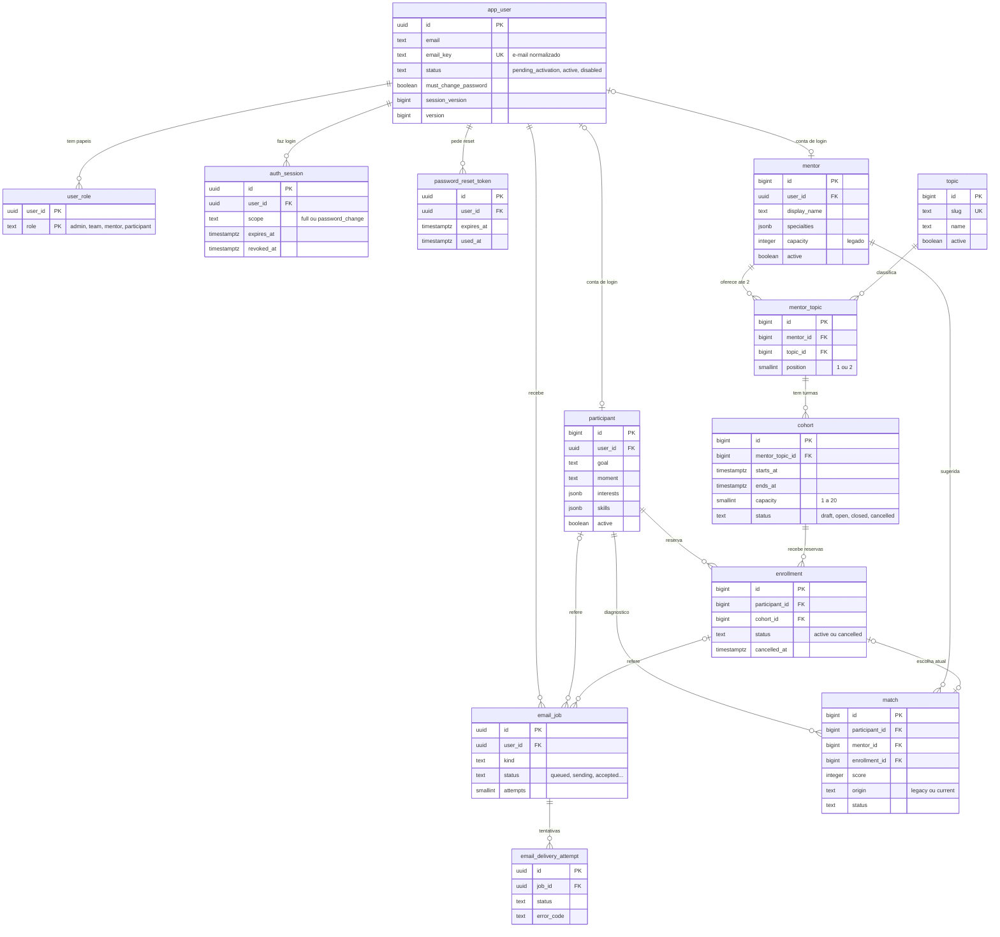
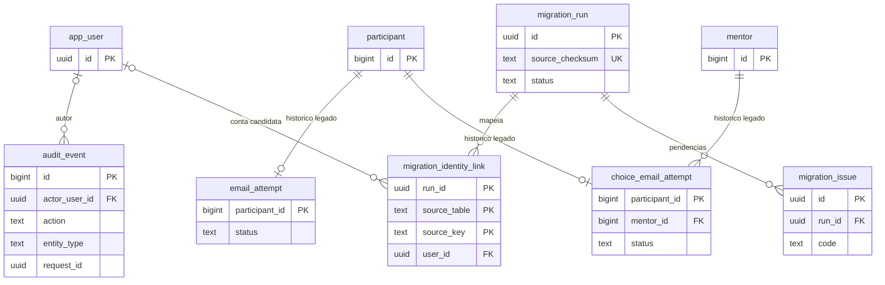

# DER e dicionário de dados — Tech Woman (PostgreSQL)

> **Para quem é:** quem está começando e quer entender **onde cada informação mora** no banco do site.
> **Fonte da verdade:** o banco **PostgreSQL 16.15** com as **27 migrations** da pasta `drizzle/` aplicadas. As colunas, tipos e regras abaixo foram **lidas do próprio banco migrado**, não copiadas de um plano. Se você mudar o schema, atualize este arquivo (veja "Como manter" no fim).
> **Status:** rascunho para aprovação do sponsor — **não enviado** à Beatriz.

## 1. O que é um DER?

**DER** é o *Diagrama Entidade-Relacionamento*: um mapa com as **tabelas** (caixas) e como elas se **ligam** (linhas). Cada tabela é como uma planilha: cada **coluna** é um campo e cada **linha** é um registro.

Como ler as linhas (notação "pé de galinha"):

| Desenho | Significa |
|---|---|
| `||--o{` | **um** para **zero ou muitos** (uma mentora tem zero ou muitos temas) |
| `||--o|` | um para zero ou um |
| `|o--o|` | zero ou um para zero ou um (ex.: uma conta pode ter, ou não, um perfil) |
| `PK` | *primary key* — chave primária, o número/código único da linha |
| `FK` | *foreign key* — chave estrangeira, aponta para a linha de outra tabela |
| `UK` | *unique key* — não pode se repetir |

## 2. Glossário português ↔ nomes do banco

O banco usa **inglês**; a conversa do dia a dia usa português. Sempre que falarmos de uma coisa, use o nome em inglês quando for escrever código ou SQL.

| Em português | No banco / código | Observação |
|---|---|---|
| tema | `topic` | assunto da mentoria |
| tema da mentora | `mentor_topic` | cada mentora tem **no máximo 2** |
| turma | `cohort` | horário com vagas (1 a 20) |
| reserva / inscrição em turma | `enrollment` | a participante garante a vaga |
| cruzamento participante × mentora | `match` | recomendação, escolha e histórico antigo |
| conta de login | `app_user` | e-mail + senha (hash) |
| papel | `user_role` | `admin`, `team`, `mentor`, `participant` |

## 3. Diagrama

O arquivo [`DER.svg`](DER.svg) é a versão **renderizada** deste diagrama (abre no navegador e dá zoom sem perder nitidez). O código-fonte abaixo é Mermaid; no VSCode, a extensão *Markdown Preview Mermaid Support* mostra o desenho direto no preview. Para gerar o SVG de novo veja "Como manter".

### 3.1 Tabelas de histórico, auditoria e migração

Estas ficam fora do desenho principal (`DER.svg`) para ele continuar legível. Mesma notação:

**Resumo em uma frase:** uma **conta** (`app_user`) pode ser **participante**, **mentora** ou as duas; a mentora escolhe até **2 temas** (`mentor_topic`); cada tema dela tem **turmas** (`cohort`) com horário e até 20 vagas; a participante faz uma **reserva** (`enrollment`) numa turma.

Tabelas sem linha no desenho (não têm chave estrangeira): `event_content`, `demo_seed_state`, `agenda_guard`, `api_context`, `api_idempotency`, `auth_rate_bucket` e `schema_migration`. As duas últimas do schema `internal` (`schema_migration` e `api_context`) nascem de SQL e não estão em `schema.ts`. Os desenhos mostram só as colunas principais; o **dicionário completo** (todas as colunas) está abaixo.

## 4. Convenções que valem para todas as tabelas

- **IDs**: tabelas herdadas e novas de domínio usam `bigint` com identidade automática (ex.: `participant`, `mentor`, `topic`, `cohort`, `enrollment`). **Na API, todo ID `bigint` viaja como texto** (`"501"`), nunca como número. Contas, sessões e jobs usam `uuid`.
- **Datas**: `timestamptz` guarda um **instante**; a API devolve em **UTC** (termina em `Z`) e a tela mostra em **America/Recife** (UTC−3, sem horário de verão). Entrada na API exige o fuso (`-03:00` ou `Z`).
- **Versão**: `version` começa em 1 e sobe a cada alteração; é o valor do cabeçalho `ETag`/`If-Match`.
- **Nada se apaga**: todas as chaves estrangeiras são `ON DELETE RESTRICT`. O site **desativa** (`active = false`, `status = 'cancelled'`) em vez de apagar, para preservar o histórico.
- **Proteções no banco** (gatilhos `agenda_*`): impedem *overlap* de horários da mesma mentora, *overlap* de reservas da mesma participante, reserva acima da capacidade e transições de status inválidas — **mesmo que alguém edite pelo pgAdmin**.
- **Schemas**: tabelas do site em `public`; `internal` guarda a trava da Agenda e o registro de migrations; `legacy_snapshot` é um arquivo privado com a cópia bruta do SQLite (não é lido pelo site).
- **Papéis do PostgreSQL** (quem acessa o banco; não confundir com os papéis do site): `techwoman_migrator` (aplica migrations), `techwoman_runtime` (o site), `techwoman_mailer` (o enviador de e-mails), `techwoman_owner` (dono, não faz login) e `techwoman_beatriz` (edição direta pelo pgAdmin, só em colunas permitidas).

## 5. Dicionário — contas e acesso (quem consegue entrar no site)

Aqui moram as **contas de login**. Uma conta (`app_user`) pode ter vários papéis (`user_role`) e ligar-se a um perfil de participante e a um de mentora ao mesmo tempo. Senhas **nunca** ficam em texto: só o resultado da conta matemática (hash).

### `app_user` — conta de login

Uma linha por pessoa que pode entrar. O e-mail é a identidade: `email_key` (minúsculo, sem espaços nas pontas) é **único**, então ninguém tem duas contas com o mesmo endereço. Contas de administradora são criadas só por operação privilegiada fora do site.

| Coluna | Tipo | Obrigatória? | Padrão | Para que serve |
|---|---|---|---|---|
| `id` 🔑 | `uuid` | sim | — | Identificador único (UUID) da conta. |
| `email` | `text` | sim | — | Endereço de login como a pessoa digitou. |
| `email_key` | `text` | sim | `gerada: lower(btrim(email))` | Versão normalizada do e-mail (minúsculas, sem espaços). Gerada pelo banco; é a que garante unicidade. |
| `password_hash` | `text` | não | — | Senha definitiva em forma de hash (`sal:resumo`). Nunca é devolvida pela API. |
| `temporary_password_hash` | `text` | não | — | Hash da senha temporária enviada por e-mail (vale 24 h). |
| `temporary_expires_at` | `timestamp with time zone` | não | — | Quando a senha temporária vence. |
| `temporary_used_at` | `timestamp with time zone` | não | — | Quando a temporária foi usada no primeiro login (só pode ser usada uma vez). |
| `credential_generation` | `bigint` | sim | `0` | Contador que sobe a cada nova senha/token emitido; e-mails atrasados de gerações antigas deixam de valer. |
| `must_change_password` | `boolean` | sim | `false` | Verdadeiro enquanto a pessoa precisa trocar a senha temporária. |
| `status` | `text` | sim | — | `pending_activation` (aguarda 1º acesso), `active` ou `disabled`. |
| `session_version` | `bigint` | sim | `0` | Sobe quando a senha muda ou a conta é desativada; derruba todas as sessões antigas. |
| `created_at` | `timestamp with time zone` | sim | `now()` | Quando a linha foi criada. |
| `updated_at` | `timestamp with time zone` | sim | `now()` | Última alteração. |
| `version` | `bigint` | sim | `1` | Número da versão da linha (sobe a cada mudança); é o valor do `ETag`/`If-Match`. |

**Regras do banco (constraints):**

- `app_user_email_key_unique` — `UNIQUE (email_key)`
- `app_user_status_check` — `CHECK ((status = ANY (ARRAY['pending_activation'::text, 'active'::text, 'disabled'::text])))`

**Gatilhos (triggers):** `touch_version`.

### `user_role` — papéis da conta

Quais papéis cada conta tem: `admin` (gestão completa do SITE), `team` (equipe, só leitura), `mentor`, `participant`. Não é papel do PostgreSQL nem login do pgAdmin.

| Coluna | Tipo | Obrigatória? | Padrão | Para que serve |
|---|---|---|---|---|
| `user_id` 🔑 | `uuid` | sim | — | A conta. |
| `role` 🔑 | `text` | sim | — | O papel: `admin`, `team`, `mentor` ou `participant`. |

**Regras do banco (constraints):**

- `user_role_check` — `CHECK ((role = ANY (ARRAY['admin'::text, 'team'::text, 'mentor'::text, 'participant'::text])))`

### `auth_session` — sessões de login

Cada login gera uma sessão. O cookie `tw_session` carrega um código aleatório; aqui fica só o **hash** dele.

| Coluna | Tipo | Obrigatória? | Padrão | Para que serve |
|---|---|---|---|---|
| `id` 🔑 | `uuid` | sim | — | Identificador da sessão. |
| `user_id` | `uuid` | sim | — | De quem é. |
| `token_hash` | `text` | sim | — | Hash do código do cookie. |
| `scope` | `text` | sim | — | `full` (acesso normal) ou `password_change` (só pode trocar a senha, dura 10 min). |
| `session_version` | `bigint` | sim | — | Cópia da `session_version` da conta no momento do login. |
| `expires_at` | `timestamp with time zone` | sim | — | Quando a sessão vence (24 h na `full`). |
| `revoked_at` | `timestamp with time zone` | não | — | Quando foi encerrada (logout ou troca de senha). |
| `created_at` | `timestamp with time zone` | sim | `now()` | Quando começou. |

**Regras do banco (constraints):**

- `auth_session_scope_check` — `CHECK ((scope = ANY (ARRAY['full'::text, 'password_change'::text])))`
- `auth_session_token_hash_unique` — `UNIQUE (token_hash)`

### `password_reset_token` — links de redefinição de senha

Cada pedido de "esqueci a senha" gera um token de uso único que vale 30 min. Só o hash é guardado.

| Coluna | Tipo | Obrigatória? | Padrão | Para que serve |
|---|---|---|---|---|
| `id` 🔑 | `uuid` | sim | — | Identificador. |
| `user_id` | `uuid` | sim | — | A conta. |
| `token_hash` | `text` | sim | — | Hash do token enviado no link. |
| `generation` | `bigint` | sim | — | Geração de credencial a que o token pertence. |
| `expires_at` | `timestamp with time zone` | sim | — | Validade (30 min). |
| `used_at` | `timestamp with time zone` | não | — | Quando foi usado. |
| `revoked_at` | `timestamp with time zone` | não | — | Quando foi cancelado por um pedido mais novo. |
| `created_at` | `timestamp with time zone` | sim | `now()` | Quando foi criado. |

**Regras do banco (constraints):**

- `password_reset_token_token_hash_unique` — `UNIQUE (token_hash)`

## 6. Dicionário — perfis do evento (participante e mentora)

Os dados do diagnóstico da participante e do cadastro da mentora. `user_id` liga o perfil à conta de login; vazio significa "cadastro antigo ainda não vinculado a uma conta".

### `participant` — participante

Diagnóstico de carreira da participante. Os IDs antigos (do SQLite) foram preservados.

| Coluna | Tipo | Obrigatória? | Padrão | Para que serve |
|---|---|---|---|---|
| `id` 🔑 | `bigint` | sim | `identidade` | Número da participante (igual ao do sistema antigo). |
| `email` | `text` | sim | — | E-mail informado no cadastro (a identidade de login é `app_user`). |
| `goal` | `text` | sim | — | Objetivo: `transition`, `growth` ou `leadership`. |
| `moment` | `text` | sim | — | Momento: `starting`, `working` ou `returning`. |
| `interests` | `jsonb` | sim | — | Lista (JSON) de 1 a 3 interesses: produto, dados, desenvolvimento, design. |
| `skills` | `jsonb` | sim | — | Lista (JSON) de 1 a 4 habilidades: comunicacao, analise, codigo, gestao. |
| `area` | `text` | não | — | Área principal ou `outra`. |
| `token_hash` | `text` | sim | — | Hash do link privado do sistema antigo (cadastros legados). |
| `consent_version` | `text` | sim | — | Versão do texto de consentimento aceito. |
| `consent_at` | `timestamp with time zone` | não | — | Quando consentiu (UTC), se a data era válida. |
| `consent_at_raw` | `text` | sim | `''::text` | Texto original da data do consentimento, preservado. |
| `user_id` | `uuid` | não | — | Conta de login vinculada (vazio = cadastro antigo ainda sem conta). |
| `legacy_access_revoked_at` | `timestamp with time zone` | não | — | Quando o acesso pelo link antigo foi desligado após a ativação. |
| `active` | `boolean` | sim | `true` | Falso = desativada (não apagada). |
| `imported_at` | `timestamp with time zone` | não | — | Preenchido só em linhas vindas da importação do SQLite. |
| `created_at` | `timestamp with time zone` | sim | `now()` | Criada no PostgreSQL em. |
| `updated_at` | `timestamp with time zone` | sim | `now()` | Última alteração. |
| `version` | `bigint` | sim | `1` | Versão da linha. |

**Regras do banco (constraints):**

- `participant_interests_array` — `CHECK ((jsonb_typeof(interests) = 'array'::text))`
- `participant_skills_array` — `CHECK ((jsonb_typeof(skills) = 'array'::text))`
- `participant_token_hash_unique` — `UNIQUE (token_hash)`
- `participant_user_id_unique` — `UNIQUE (user_id)`

**Gatilhos (triggers):** `agenda_guard`, `agenda_profile_format`, `agenda_row`, `agenda_row_immutable`, `agenda_validate`, `touch_version`.

### `mentor` — mentora

Cadastro da mentora. `capacity` é a capacidade **antiga** (compatibilidade); o limite real de vagas agora é da **turma** (`cohort.capacity`).

| Coluna | Tipo | Obrigatória? | Padrão | Para que serve |
|---|---|---|---|---|
| `id` 🔑 | `bigint` | sim | `identidade` | Número da mentora (igual ao do sistema antigo). |
| `email` | `text` | sim | — | E-mail informado no cadastro. |
| `trajectory` | `text` | sim | — | Trajetória profissional (texto, até 1000 caracteres). |
| `specialties` | `jsonb` | sim | — | Lista (JSON) de 1 a 3 especialidades. |
| `availability` | `text` | sim | — | Disponibilidade em texto livre (informativa; não é horário de turma). |
| `capacity` | `integer` | sim | — | Capacidade legada (1 a 50). Não cria turma. |
| `active` | `boolean` | sim | `true` | Falso = desativada. |
| `demo` | `boolean` | sim | `false` | Verdadeiro nas mentoras fictícias de demonstração. |
| `demo_name` | `text` | não | — | Nome da mentora fictícia. |
| `display_name` | `text` | não | — | Nome exibido (se vazio, o site mostra "Mentora #número"). |
| `user_id` | `uuid` | não | — | Conta de login vinculada. |
| `consent_version` | `text` | não | — | Versão do consentimento. |
| `consent_at` | `timestamp with time zone` | não | — | Quando consentiu. |
| `imported_at` | `timestamp with time zone` | não | — | Só em linhas importadas. |
| `created_at` | `timestamp with time zone` | sim | `now()` | Criada em. |
| `updated_at` | `timestamp with time zone` | sim | `now()` | Última alteração. |
| `version` | `bigint` | sim | `1` | Versão da linha. |

**Regras do banco (constraints):**

- `mentor_capacity_check` — `CHECK ((capacity > 0))`
- `mentor_specialties_array` — `CHECK ((jsonb_typeof(specialties) = 'array'::text))`
- `mentor_user_id_unique` — `UNIQUE (user_id)`

**Gatilhos (triggers):** `agenda_guard`, `agenda_profile_format`, `agenda_row`, `agenda_row_immutable`, `agenda_validate`, `touch_version`.

## 7. Dicionário — Agenda: temas, turmas e reservas

O coração da evolução: **tema** (topic) → a mentora oferece até 2 (**mentor_topic**) → cada um tem **turmas** (cohort) com horário e vagas → a participante faz uma **reserva** (enrollment). `match` guarda a recomendação/escolha e o histórico antigo.

### `topic` — tema

Assunto de mentoria (ex.: Dados, Design). O `slug` é o apelido sem acento e sem espaço (`produto-digital`) e não muda depois de criado. Não existem temas pré-cadastrados.

| Coluna | Tipo | Obrigatória? | Padrão | Para que serve |
|---|---|---|---|---|
| `id` 🔑 | `bigint` | sim | `identidade` | Número do tema. |
| `slug` | `text` | sim | — | Apelido único: minúsculas, números e hífen (1 a 80 caracteres). |
| `name` | `text` | sim | — | Nome exibido (1 a 120). |
| `description` | `text` | sim | `''::text` | Descrição (até 1000). |
| `active` | `boolean` | sim | `true` | Falso = tema desativado. |
| `created_at` | `timestamp with time zone` | sim | `now()` | Criado em. |
| `updated_at` | `timestamp with time zone` | sim | `now()` | Última alteração. |
| `version` | `bigint` | sim | `1` | Versão da linha. |

**Regras do banco (constraints):**

- `topic_description_length` — `CHECK ((length(description) <= 1000))`
- `topic_name_length` — `CHECK ((((length(btrim(name)) >= 1) AND (length(btrim(name)) <= 120)) AND (length(name) <= 120)))`
- `topic_slug_format` — `CHECK ((((length(slug) >= 1) AND (length(slug) <= 80)) AND (slug ~ '^[a-z0-9]+(-[a-z0-9]+)*$'::text)))`
- `topic_slug_unique` — `UNIQUE (slug)`

**Gatilhos (triggers):** `agenda_guard`, `agenda_row`, `agenda_row_immutable`, `agenda_validate`, `touch_version`.

### `mentor_topic` — tema da mentora (limite 2)

Liga a mentora aos temas que ela oferece. **No máximo 2 por mentora**: a posição só pode ser 1 ou 2 e é única por mentora. Depois que existe turma, o vínculo não é reapontado.

| Coluna | Tipo | Obrigatória? | Padrão | Para que serve |
|---|---|---|---|---|
| `id` 🔑 | `bigint` | sim | `identidade` | Número do vínculo. |
| `mentor_id` | `bigint` | sim | — | A mentora. |
| `topic_id` | `bigint` | sim | — | O tema. |
| `position` | `smallint` | sim | — | Posição 1 ou 2 (única por mentora). |
| `created_at` | `timestamp with time zone` | sim | `now()` | Criado em. |
| `updated_at` | `timestamp with time zone` | sim | `now()` | Última alteração. |
| `version` | `bigint` | sim | `1` | Versão da linha. |

**Regras do banco (constraints):**

- `mentor_topic_pair_unique` — `UNIQUE (mentor_id, topic_id)`
- `mentor_topic_position_check` — `CHECK (("position" = ANY (ARRAY[1, 2])))`
- `mentor_topic_position_unique` — `UNIQUE (mentor_id, "position") DEFERRABLE`

**Gatilhos (triggers):** `agenda_guard`, `agenda_row`, `agenda_row_immutable`, `agenda_validate`, `touch_version`.

### `cohort` — turma

Um horário de mentoria de um tema de uma mentora. **Capacidade de 1 a 20** vagas; o fim é sempre depois do início; datas em UTC. Dois horários da mesma mentora **não podem se sobrepor** (overlap), mesmo em temas diferentes.

| Coluna | Tipo | Obrigatória? | Padrão | Para que serve |
|---|---|---|---|---|
| `id` 🔑 | `bigint` | sim | `identidade` | Número da turma. |
| `mentor_topic_id` | `bigint` | sim | — | Qual tema da mentora. |
| `starts_at` | `timestamp with time zone` | sim | — | Início (instante em UTC; no Recife = UTC − 3 h). |
| `ends_at` | `timestamp with time zone` | sim | — | Fim (exclusivo: 10:00 termina quando outra de 10:00 começa). |
| `capacity` | `smallint` | sim | — | Vagas (1 a 20). |
| `status` | `text` | sim | — | `draft` (rascunho), `open` (aceita reservas), `closed` (fechada, mantém quem já reservou) ou `cancelled` (terminal). |
| `created_at` | `timestamp with time zone` | sim | `now()` | Criada em. |
| `updated_at` | `timestamp with time zone` | sim | `now()` | Última alteração. |
| `version` | `bigint` | sim | `1` | Versão da linha. |

**Regras do banco (constraints):**

- `cohort_capacity_check` — `CHECK (((capacity >= 1) AND (capacity <= 20)))`
- `cohort_status_check` — `CHECK ((status = ANY (ARRAY['draft'::text, 'open'::text, 'closed'::text, 'cancelled'::text])))`
- `cohort_time_check` — `CHECK ((ends_at > starts_at))`

**Gatilhos (triggers):** `agenda_guard`, `agenda_row`, `agenda_row_immutable`, `agenda_validate`, `touch_version`.

### `enrollment` — reserva

A reserva de uma participante numa turma. Não precisa de aprovação humana. Uma participante não pode ter duas reservas ativas em horários que se sobrepõem, nem a mesma turma duas vezes, e a turma nunca passa da capacidade.

| Coluna | Tipo | Obrigatória? | Padrão | Para que serve |
|---|---|---|---|---|
| `id` 🔑 | `bigint` | sim | `identidade` | Número da reserva. |
| `participant_id` | `bigint` | sim | — | Quem reservou. |
| `cohort_id` | `bigint` | sim | — | Qual turma. |
| `status` | `text` | sim | — | `active` ou `cancelled`. |
| `cancelled_at` | `timestamp with time zone` | não | — | Quando foi cancelada. |
| `created_at` | `timestamp with time zone` | sim | `now()` | Reservada em. |
| `updated_at` | `timestamp with time zone` | sim | `now()` | Última alteração. |
| `version` | `bigint` | sim | `1` | Versão da linha. |

**Regras do banco (constraints):**

- `enrollment_status_check` — `CHECK ((status = ANY (ARRAY['active'::text, 'cancelled'::text])))`
- `enrollment_active_unique` (índice único parcial) — `btree (participant_id, cohort_id) WHERE (status = 'active'::text)`

**Gatilhos (triggers):** `agenda_enrollment_effects`, `agenda_enrollment_stamp`, `agenda_guard`, `agenda_row`, `agenda_row_immutable`, `agenda_validate`, `touch_version`.

### `match` — cruzamento participante × mentora

Guarda sugestões, escolhas e o histórico. `origin='legacy'` são cruzamentos do sistema antigo (preservados, sem horário inventado); `origin='current'` acompanham reservas novas. **Não** é a fonte da contagem de vagas.

| Coluna | Tipo | Obrigatória? | Padrão | Para que serve |
|---|---|---|---|---|
| `id` 🔑 | `bigint` | sim | `identidade` | Número do cruzamento (preservado do sistema antigo). |
| `participant_id` | `bigint` | sim | — | A participante. |
| `mentor_id` | `bigint` | sim | — | A mentora. |
| `score` | `integer` | sim | — | Pontuação da recomendação. |
| `reasons` | `jsonb` | sim | — | Lista (JSON) com as razões legíveis da pontuação. |
| `status` | `text` | sim | — | `approved`/`rejected` (legado), `suggested`, `selected` ou `cancelled`. |
| `origin` | `text` | sim | `'legacy'::text` | `legacy` ou `current`. |
| `enrollment_id` | `bigint` | não | — | Reserva ligada (só em `current`). |
| `imported_at` | `timestamp with time zone` | não | — | Só em linhas importadas. |
| `created_at` | `timestamp with time zone` | sim | `now()` | Criado em. |
| `updated_at` | `timestamp with time zone` | sim | `now()` | Última alteração. |
| `version` | `bigint` | sim | `1` | Versão da linha. |

**Regras do banco (constraints):**

- `match_enrollment_id_unique` — `UNIQUE (enrollment_id)`
- `match_origin_check` — `CHECK ((origin = ANY (ARRAY['legacy'::text, 'current'::text])))`
- `match_reasons_array` — `CHECK ((jsonb_typeof(reasons) = 'array'::text))`
- `match_status_check` — `CHECK ((status = ANY (ARRAY['approved'::text, 'rejected'::text, 'suggested'::text, 'selected'::text, 'cancelled'::text])))`
- `one_approved_match` (índice único parcial) — `btree (participant_id) WHERE ((origin = 'legacy'::text) AND (status = 'approved'::text))`

**Gatilhos (triggers):** `agenda_match_guard`, `touch_version`.

## 8. Dicionário — e-mails (fila e histórico)

O site **não envia e-mail dentro do pedido**: grava uma intenção na fila (`email_job`) e um processo separado (o *mailer*) envia depois. Nada nessas tabelas guarda senha, token ou texto da mensagem.

### `email_job` — fila de e-mails

Uma linha = uma intenção de enviar e-mail. **Sem** corpo, senha ou link. Estados: `queued` (na fila), `sending` (em envio), `accepted` (o provedor aceitou — **não** prova que chegou), `unconfirmed` (não se sabe se saiu; será refeito com credencial nova), `failed` (esgotou tentativas), `simulated` (modo local: **NÃO ENVIADA — simulação**), `cancelled` (obsoleta).

| Coluna | Tipo | Obrigatória? | Padrão | Para que serve |
|---|---|---|---|---|
| `id` 🔑 | `uuid` | sim | — | Identificador do job. |
| `user_id` | `uuid` | sim | — | Destinatária (o endereço é lido da conta no momento do envio). |
| `kind` | `text` | sim | — | `temporary_password`, `password_reset`, `registration` ou `reservation`. |
| `generation` | `bigint` | sim | — | Geração de credencial do job. |
| `status` | `text` | sim | — | Estado atual (veja acima). |
| `attempts` | `smallint` | sim | `0` | Tentativas feitas (máx. 3). |
| `next_attempt_at` | `timestamp with time zone` | não | — | Quando tentar de novo. |
| `lease_until` | `timestamp with time zone` | não | — | Reserva temporária (60 s) do worker que está enviando. |
| `lease_owner` | `uuid` | não | — | Qual worker pegou o job. |
| `dedupe_key` | `text` | sim | — | Chave que impede jobs duplicados. |
| `participant_id` | `bigint` | não | — | Participante relacionada (se houver). |
| `enrollment_id` | `bigint` | não | — | Reserva relacionada (e-mail de reserva). |
| `created_at` | `timestamp with time zone` | sim | `now()` | Criado em. |
| `updated_at` | `timestamp with time zone` | sim | `now()` | Última alteração. |

**Regras do banco (constraints):**

- `email_job_dedupe_key_unique` — `UNIQUE (dedupe_key)`
- `email_job_kind_check` — `CHECK ((kind = ANY (ARRAY['temporary_password'::text, 'password_reset'::text, 'registration'::text, 'reservation'::text])))`
- `email_job_status_check` — `CHECK ((status = ANY (ARRAY['queued'::text, 'sending'::text, 'accepted'::text, 'unconfirmed'::text, 'failed'::text, 'simulated'::text, 'cancelled'::text])))`

### `email_delivery_attempt` — tentativas de envio

Metadados de cada tentativa de um job (nunca o conteúdo).

| Coluna | Tipo | Obrigatória? | Padrão | Para que serve |
|---|---|---|---|---|
| `id` 🔑 | `uuid` | sim | — | Identificador. |
| `job_id` | `uuid` | sim | — | O job. |
| `generation` | `bigint` | sim | — | Geração da credencial usada. |
| `status` | `text` | sim | — | Resultado da tentativa. |
| `provider_id` | `text` | não | — | Código devolvido pelo provedor (se houver). |
| `error_code` | `text` | não | — | Código de erro padronizado (sem detalhes sensíveis). |
| `created_at` | `timestamp with time zone` | sim | `now()` | Início. |
| `completed_at` | `timestamp with time zone` | não | — | Fim. |

### `email_attempt` — histórico: e-mail de inscrição (legado)

Histórico do sistema antigo, só leitura depois da importação.

| Coluna | Tipo | Obrigatória? | Padrão | Para que serve |
|---|---|---|---|---|
| `participant_id` 🔑 | `bigint` | sim | — | Participante. |
| `status` | `text` | sim | — | Status que o sistema antigo gravou. |
| `provider_id` | `text` | não | — | Código do provedor. |
| `updated_at` | `timestamp with time zone` | não | — | Data (UTC) quando válida. |
| `updated_at_raw` | `text` | sim | `''::text` | Texto original da data. |

### `choice_email_attempt` — histórico: e-mail de escolha (legado)

Histórico do sistema antigo, só leitura depois da importação.

| Coluna | Tipo | Obrigatória? | Padrão | Para que serve |
|---|---|---|---|---|
| `participant_id` 🔑 | `bigint` | sim | — | Participante. |
| `status` | `text` | sim | — | Status que o sistema antigo gravou. |
| `provider_id` | `text` | não | — | Código do provedor. |
| `updated_at` | `timestamp with time zone` | não | — | Data (UTC) quando válida. |
| `updated_at_raw` | `text` | sim | `''::text` | Texto original da data. |
| `mentor_id` | `bigint` | sim | — | Mentora escolhida. |

## 9. Dicionário — conteúdo do evento e auditoria

Texto da página do evento, marcador da demonstração e o diário de quem mudou o quê.

### `event_content` — textos do evento

Uma única linha (`id = 1`) com os textos da página do evento. O campo `agenda` é um **texto livre** — não é a Agenda de turmas.

| Coluna | Tipo | Obrigatória? | Padrão | Para que serve |
|---|---|---|---|---|
| `id` 🔑 | `integer` | sim | — | Sempre 1. |
| `description` | `text` | sim | — | Descrição. |
| `venue` | `text` | sim | — | Local. |
| `agenda` | `text` | sim | — | Programação em texto. |
| `speakers` | `text` | sim | — | Palestrantes em texto. |
| `date` | `text` | sim | — | Data civil em texto (ex.: 2026-11-14), não é instante. |
| `duration` | `text` | sim | — | Duração. |
| `updated_at` | `timestamp with time zone` | sim | `now()` | Última alteração. |
| `version` | `bigint` | sim | `1` | Versão. |

**Regras do banco (constraints):**

- `event_content_singleton` — `CHECK ((id = 1))`

**Gatilhos (triggers):** `touch_version`.

### `demo_seed_state` — marcador da demonstração

Se a linha existe, as mentoras fictícias já foram criadas (o seed não repete).

| Coluna | Tipo | Obrigatória? | Padrão | Para que serve |
|---|---|---|---|---|
| `id` 🔑 | `integer` | sim | — | Sempre 1. |

**Regras do banco (constraints):**

- `demo_seed_singleton` — `CHECK ((id = 1))`

### `audit_event` — auditoria

Diário imutável de ações sensíveis: quem fez, o quê, em qual registro. Guarda **nomes** dos campos alterados, nunca valores, e-mails ou senhas.

| Coluna | Tipo | Obrigatória? | Padrão | Para que serve |
|---|---|---|---|---|
| `id` 🔑 | `bigint` | sim | `identidade` | Número do evento. |
| `actor_user_id` | `uuid` | não | — | Quem fez. |
| `action` | `text` | sim | — | Ação. |
| `entity_type` | `text` | sim | — | Tipo do registro. |
| `entity_id` | `text` | sim | — | Identificador do registro. |
| `changed_fields` | `jsonb` | sim | — | Lista (JSON) dos nomes dos campos. |
| `result` | `text` | sim | — | Resultado. |
| `request_id` | `uuid` | sim | — | Código do pedido HTTP (aparece no `requestId`). |
| `created_at` | `timestamp with time zone` | sim | `now()` | Quando. |

**Regras do banco (constraints):**

- `audit_fields_array` — `CHECK ((jsonb_typeof(changed_fields) = 'array'::text))`

## 10. Dicionário — tabelas técnicas de proteção

Você normalmente **não mexe** nelas. Garantem que duas pessoas não reservem a última vaga ao mesmo tempo, que um clique repetido não duplique nada e que tentativas de login sejam limitadas.

### `agenda_guard` — trava global da Agenda (schema internal)

Uma linha que toda alteração de Agenda atualiza. Isso faz o PostgreSQL **enfileirar** quem reserva ao mesmo tempo, evitando vaga a mais. Ninguém (nem pgAdmin) acessa direto.

| Coluna | Tipo | Obrigatória? | Padrão | Para que serve |
|---|---|---|---|---|
| `id` 🔑 | `smallint` | sim | — | Sempre 1. |
| `revision` | `bigint` | sim | — | Contador que sobe a cada mudança na Agenda. |

**Regras do banco (constraints):**

- `agenda_guard_singleton` — `CHECK ((id = 1))`

### `api_idempotency` — memória de Idempotency-Key

Lembra por 24 h cada `Idempotency-Key` já usada, para que repetir o mesmo pedido não crie duas coisas.

| Coluna | Tipo | Obrigatória? | Padrão | Para que serve |
|---|---|---|---|---|
| `id` 🔑 | `uuid` | sim | — | Identificador. |
| `actor_key` | `text` | sim | — | Quem pediu (identificado por hash). |
| `method` | `text` | sim | — | Método HTTP. |
| `path` | `text` | sim | — | Caminho. |
| `key_hash` | `text` | sim | — | Hash da chave. |
| `request_hash` | `text` | sim | — | Hash do corpo (mesmo corpo = mesma resposta; corpo diferente = 409). |
| `resource_id` | `text` | não | — | Recurso criado. |
| `status_code` | `integer` | não | — | Código HTTP devolvido. |
| `expires_at` | `timestamp with time zone` | sim | — | Quando esquece (24 h). |
| `created_at` | `timestamp with time zone` | sim | `now()` | Criada em. |

**Regras do banco (constraints):**

- `api_idempotency_scope_unique` — `UNIQUE (actor_key, method, path, key_hash)`

### `auth_rate_bucket` — limite de tentativas

Contadores que limitam login, cadastro e recuperação. A chave é um HMAC: o banco nunca vê e-mail ou IP.

| Coluna | Tipo | Obrigatória? | Padrão | Para que serve |
|---|---|---|---|---|
| `bucket_key` 🔑 | `text` | sim | — | Chave do contador (HMAC). |
| `window_start` | `timestamp with time zone` | sim | — | Início da janela. |
| `count` | `integer` | sim | — | Tentativas na janela. |
| `expires_at` | `timestamp with time zone` | sim | — | Quando o contador some. |

### `api_context` — contexto da transação (schema internal)

Guarda, só durante cada transação, **quem está agindo** (conta) e o `requestId` do pedido, para que as funções do banco gravem a auditoria certa. Linhas com mais de 1 hora são limpas sozinhas. Existe só nas migrations SQL (não está em `schema.ts`) e ninguém a acessa direto.

| Coluna | Tipo | Obrigatória? | Padrão | Para que serve |
|---|---|---|---|---|
| `xact` 🔑 | `xid8` | sim | — | Identificador da transação (chave). |
| `actor` | `uuid` | sim | — | Conta que está agindo. |
| `request` | `uuid` | sim | — | `requestId` do pedido HTTP. |
| `created_at` | `timestamp with time zone` | sim | `now()` | Quando foi gravada. |

## 11. Dicionário — controle da migração (SQLite → PostgreSQL)

Usadas só na troca de banco e no controle das migrations. Não aparecem no uso diário.

### `migration_run` — execução da importação

Uma linha por importação do SQLite (identificada pelo checksum da cópia).

| Coluna | Tipo | Obrigatória? | Padrão | Para que serve |
|---|---|---|---|---|
| `id` 🔑 | `uuid` | sim | — | Identificador. |
| `source_checksum` | `text` | sim | — | Checksum lógico da cópia importada. |
| `cutoff_at` | `timestamp with time zone` | não | — | Ponto de corte. |
| `status` | `text` | sim | — | Estado. |
| `created_at` | `timestamp with time zone` | sim | `now()` | Criada em. |

**Regras do banco (constraints):**

- `migration_run_source_checksum_unique` — `UNIQUE (source_checksum)`

### `migration_identity_link` — mapa privado de identidades

Liga registros antigos a contas candidatas. **Privado**: nem o site nem a editora leem.

| Coluna | Tipo | Obrigatória? | Padrão | Para que serve |
|---|---|---|---|---|
| `run_id` 🔑 | `uuid` | sim | — | Importação. |
| `source_table` 🔑 | `text` | sim | — | Tabela de origem. |
| `source_key` 🔑 | `text` | sim | — | Chave na origem. |
| `user_id` | `uuid` | não | — | Conta candidata. |
| `resolution` | `text` | sim | — | Situação da resolução. |

### `migration_issue` — pendências da importação

Pendências que o operador precisa resolver.

| Coluna | Tipo | Obrigatória? | Padrão | Para que serve |
|---|---|---|---|---|
| `id` 🔑 | `uuid` | sim | — | Identificador. |
| `run_id` | `uuid` | sim | — | Importação. |
| `source_table` | `text` | sim | — | Tabela de origem. |
| `source_key` | `text` | sim | — | Chave na origem. |
| `code` | `text` | sim | — | Código da pendência. |
| `resolved_at` | `timestamp with time zone` | não | — | Quando foi resolvida. |

### `schema_migration` — registro das migrations aplicadas (schema internal)

Lista quais arquivos de `drizzle/` já rodaram e o checksum de cada um. Se um arquivo já aplicado mudar, o migrador recusa.

| Coluna | Tipo | Obrigatória? | Padrão | Para que serve |
|---|---|---|---|---|
| `name` 🔑 | `text` | sim | — | Nome do arquivo de migration. |
| `checksum` | `text` | sim | — | SHA-256 do conteúdo (com quebras de linha normalizadas). |
| `applied_at` | `timestamp with time zone` | sim | `now()` | Quando rodou. |

## 12. Chaves estrangeiras (todas `ON DELETE RESTRICT`)

Cada linha diz: a tabela da esquerda **depende** da tabela da direita. `RESTRICT` significa que o banco **recusa apagar** uma linha que ainda é usada por outra — por isso o site desativa/cancela em vez de apagar.

| Tabela | Constraint | Aponta para |
|---|---|---|
| `audit_event` | `audit_event_actor_user_id_app_user_id_fk` | `(actor_user_id) REFERENCES app_user(id)` |
| `auth_session` | `auth_session_user_id_app_user_id_fk` | `(user_id) REFERENCES app_user(id)` |
| `choice_email_attempt` | `choice_email_attempt_mentor_id_mentor_id_fk` | `(mentor_id) REFERENCES mentor(id)` |
| `choice_email_attempt` | `choice_email_attempt_participant_id_participant_id_fk` | `(participant_id) REFERENCES participant(id)` |
| `cohort` | `cohort_mentor_topic_id_mentor_topic_id_fk` | `(mentor_topic_id) REFERENCES mentor_topic(id)` |
| `email_attempt` | `email_attempt_participant_id_participant_id_fk` | `(participant_id) REFERENCES participant(id)` |
| `email_delivery_attempt` | `email_delivery_attempt_job_id_email_job_id_fk` | `(job_id) REFERENCES email_job(id)` |
| `email_job` | `email_job_enrollment_id_enrollment_id_fk` | `(enrollment_id) REFERENCES enrollment(id)` |
| `email_job` | `email_job_participant_id_participant_id_fk` | `(participant_id) REFERENCES participant(id)` |
| `email_job` | `email_job_user_id_app_user_id_fk` | `(user_id) REFERENCES app_user(id)` |
| `enrollment` | `enrollment_cohort_id_cohort_id_fk` | `(cohort_id) REFERENCES cohort(id)` |
| `enrollment` | `enrollment_participant_id_participant_id_fk` | `(participant_id) REFERENCES participant(id)` |
| `match` | `match_enrollment_id_enrollment_id_fk` | `(enrollment_id) REFERENCES enrollment(id)` |
| `match` | `match_mentor_id_mentor_id_fk` | `(mentor_id) REFERENCES mentor(id)` |
| `match` | `match_participant_id_participant_id_fk` | `(participant_id) REFERENCES participant(id)` |
| `mentor` | `mentor_user_id_app_user_id_fk` | `(user_id) REFERENCES app_user(id)` |
| `mentor_topic` | `mentor_topic_mentor_id_mentor_id_fk` | `(mentor_id) REFERENCES mentor(id)` |
| `mentor_topic` | `mentor_topic_topic_id_topic_id_fk` | `(topic_id) REFERENCES topic(id)` |
| `migration_identity_link` | `migration_identity_link_run_id_migration_run_id_fk` | `(run_id) REFERENCES migration_run(id)` |
| `migration_identity_link` | `migration_identity_link_user_id_app_user_id_fk` | `(user_id) REFERENCES app_user(id)` |
| `migration_issue` | `migration_issue_run_id_migration_run_id_fk` | `(run_id) REFERENCES migration_run(id)` |
| `participant` | `participant_user_id_app_user_id_fk` | `(user_id) REFERENCES app_user(id)` |
| `password_reset_token` | `password_reset_token_user_id_app_user_id_fk` | `(user_id) REFERENCES app_user(id)` |
| `user_role` | `user_role_user_id_app_user_id_fk` | `(user_id) REFERENCES app_user(id)` |

## 13. Visões (views) para a edição direta no pgAdmin

`mentor_editor`, `participant_editor` mostram só os campos de perfil que a editora (Beatriz) pode consultar, **sem e-mail nem token**. O acesso às tabelas-base é restrito por coluna e por linha (RLS).

## 14. Como manter este arquivo

1. Mudou o schema? Edite `src/lib/schema.ts` e gere a migration (`pnpm exec drizzle-kit generate`) — **nunca** edite uma migration já aplicada (o migrador recusa).
2. Aplique no banco local (`pnpm db:migrate`) e confira as colunas direto no banco (`\d+ nome_da_tabela` no `psql`, ou o pgAdmin).
3. Atualize o bloco `mermaid` da seção 3 e as tabelas do dicionário. Cada relação do desenho precisa existir como chave estrangeira no banco, e vice-versa.
4. Gere o `DER.svg` de novo: cole o bloco `mermaid` em <https://mermaid.live> e use **Actions → SVG**, ou use o comando `mmdc` do pacote `@mermaid-js/mermaid-cli`.
5. Peça revisão no Pull Request (veja o capítulo 6 do manual).

